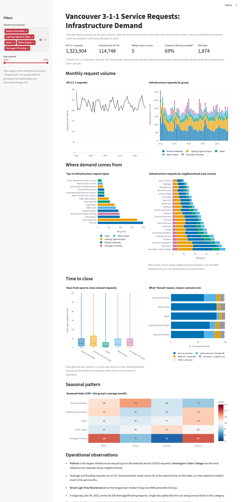

# Vancouver 3-1-1 SQL Analytics

PostgreSQL analysis of 1.32 million City of Vancouver 3-1-1 service requests (Jan 2022 to Nov 2026), focused on infrastructure demand: roads, lighting and signals, sewer, water supply, and drainage/flooding.



## What is here
- **Database:** text-only staging table, cleaned fact table and five lookup tables, with PK/FK/CHECK constraints and two indexes (`sql/01-04`).
- **14 analytical queries** (`sql/queries/`, results in `results/`): joins, CTEs, window functions (`rank`, `lag`, rolling averages, z-scores), `CASE`/`FILTER` pivots, percentiles, subqueries.
- **Analytical views** used by the queries and the dashboard.
- **EXPLAIN ANALYZE** evaluation: a composite index cut one query from about 40 ms to 3 ms (`docs/query_optimization.md`).
- **Validation** (`src/validate.py`): 11 checks recomputing key metrics from the raw CSV in pandas.
- **Dashboard** (Streamlit + Plotly). Power BI Desktop does not run on macOS, so I used Streamlit.

## Selected findings
See `docs/methodology.md` for all findings and limitations.
- 114,748 requests (8.7%) fall in the infrastructure groups I defined; Pothole and Street Light Out are the largest types.
- Drainage & Flooding demand is 2.6x higher in autumn/winter than in summer (seasonal index 136-137 vs 52) and is driven by single-day spikes (326 requests on 2023-12-04).
- "Closed" is not "fixed": only 61% of closed Roads & Sidewalks and Drainage requests are closed as "Service provided", versus 84% for Sewer and Water Supply. The rest were handed off, referred, or closed with no action.

## Run it
Requires Python 3.11+ and PostgreSQL 14+ (developed on PostgreSQL 16, macOS).

```
python3 -m venv .venv && source .venv/bin/activate
pip install -r requirements.txt
createdb vancouver_311                  # uses standard PG* env vars for connection
python src/download.py                  # ~260 MB CSV into data/raw/ (takes a few minutes)
python src/load.py                      # rebuilds schema, loads, transforms (~25 s)
python src/validate.py                  # independent checks, exits non-zero on failure
python src/run_queries.py               # writes results/*.csv
streamlit run dashboard/app.py
```

`load.py` drops and recreates the `staging` and `analytics` schemas, so it is safe to re-run.

## Layout
```
sql/            schema, transform, constraints/indexes, views
sql/queries/    14 analytical queries (each has a header comment)
sql/explain/    EXPLAIN ANALYZE script
src/            download, load, run_queries, validate
dashboard/      Streamlit app
docs/           methodology, data dictionary, data source, optimization notes, screenshot
results/        query outputs (CSV) for the snapshot
```

## Data and licence
City of Vancouver Open Data, 3-1-1 service requests, under the Open Government Licence - Vancouver. Snapshot details and hash are in `docs/data_source.md`. Code in this repository is MIT licensed.
